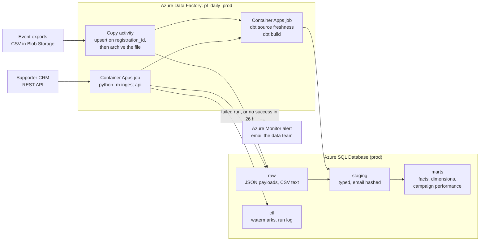

<div align="center">

# Azure Data Factory, dbt and Azure SQL warehouse

**A warehouse foundation that a small analytics team can run after the engineer who built it has left: loads that run on time and are provably right, dbt with separate dev and prod environments, Data Factory starting dbt only after the loads succeed, alerts when anything fails or goes quiet, and a runbook.**

[](https://github.com/gbadedata/azure-adf-dbt-warehouse/actions/workflows/ci.yml)


[Results](#results) · [Architecture](#architecture) · [How a day runs](#how-a-day-runs) · [Environments](#environments) · [What is verified](#what-has-and-has-not-been-verified) · [Runbook](docs/runbook.md) · [Handover](docs/handover.md) · [Decisions](docs/decisions.md)

</div>

The data is a charity's: supporters, donations and campaigns from a CRM's REST API, and event registrations exported as CSV files. All of it is **synthetic** and generated from a fixed seed. No real organisation or person is involved.

## Results

From the CI run on 13 November 2026, against SQL Server 2022: two days of source data loaded incrementally, the second day replayed, `dbt build`, then every campaign figure recomputed from the source files in plain Python and compared with the warehouse.

| 100 of 100 | 4 of 4 | 59 of 59 | 0 |
|:---:|:---:|:---:|:---:|
| campaign figures matching the source exactly | late-arriving donations caught by the overlap window | dbt models and tests passed | rows changed when the whole day was loaded a second time |

What each load did, from the run log (`ctl.ingestion_runs`):

| Load | Requested since | Received | Inserted | Updated | Unchanged | 429s retried |
|---|---|---:|---:|---:|---:|---:|
| Day 1 campaigns | everything | 10 | 10 | 0 | 0 | 0 |
| Day 1 supporters | everything | 2,400 | 2,400 | 0 | 0 | 4 |
| Day 1 donations | everything | 7,179 | 7,179 | 0 | 0 | 12 |
| Day 1 event file | (file) | 300 | 300 | 0 | 0 | - |
| Day 2 campaigns | watermark - 30 min | 1 | 0 | 1 | 0 | 0 |
| Day 2 supporters | watermark - 30 min | 151 | 120 | 30 | 1 | 0 |
| Day 2 donations | watermark - 30 min | 420 | 354 | 65 | 1 | 1 |
| Day 2 event file | (file) | 85 | 60 | 5 | 20 | - |
| Replay, all three entities | new watermark - 30 min | 19 | 0 | 0 | 19 | 0 |
| Replay, event file | (file) | 85 | 0 | 0 | 85 | - |

Day 2 donations are exactly what changed in the source: 350 new gifts, 40 refunds and 25 pending gifts that cleared, plus **4 late commits**: donations stamped eight minutes *before* the day-one high watermark that only became visible on day two. A loader that asks for "everything after the watermark" never sees them. This one re-reads a 30-minute overlap, and the merge only accepts strictly newer versions, so the overlap costs one re-read row and loses nothing. [A unit test](tests/test_pipeline.py) shows the same day loaded with no overlap losing exactly those four.

The mock API also rate-limited every seventh request; the loader waited out each `Retry-After` and carried on.

**A pass here has a narrow meaning.** I generated the data, so it shows the pipeline does what it claims on that data. It is not a production track record, and Azure itself has not been exercised yet: see [what is verified](#what-has-and-has-not-been-verified).

## Architecture



Everything is in Terraform ([`infra/terraform`](infra/terraform)): the SQL server with a serverless database per environment, landing storage, Data Factory with its linked services, datasets, pipelines and triggers, the Container Apps jobs and registry, Log Analytics, and the alerts. Every service signs in with a managed identity. There are no keys or passwords in the code or in Data Factory; SQL logins are disabled on the server.

## How a day runs

1. **06:10 UTC**: the schedule trigger starts `pl_daily_prod`.
2. **In parallel:**
   - `LoadCrmApi` starts the ingest job and waits for it. For campaigns, supporters and donations it asks the API for everything changed since the high watermark minus 30 minutes, follows the cursor through every page, retries 429s (honouring `Retry-After`) and 5xx responses with backoff, and `MERGE`s each page into `raw`. The watermark moves only once every page is in. A failure leaves it where it was, so the next run simply repeats the work.
   - `LoadEventFiles` lists `prod/incoming/event_registrations/`, upserts each CSV into `raw.event_registrations` on `registration_id`, and only after a successful upsert moves the file to `prod/archive/yyyy/MM/dd/`. A file that fails stays in `incoming` for the next run.
3. `BuildDbt` runs **only if both loads succeeded**: `dbt source freshness` (fails if a source has not loaded for 50 hours), then `dbt build`, which builds every model and runs every test. A failed test fails the job.
4. Any failure fails the pipeline, which fires the **failed-run alert**. If prod has had no successful run for 26 hours, for example because the trigger was switched off, a **silence alert** fires too.

The orchestration is in [`adf/pipelines`](adf/pipelines). Data Factory starts each job through the Azure Resource Manager API as its own managed identity, then polls the execution every 30 seconds ([`run_job.json.tftpl`](adf/pipelines/run_job.json.tftpl)).

## Environments

| Target | Database | Schemas | Signs in as | Used by |
|---|---|---|---|---|
| `local` | dev | `dbt_<you>_staging`, `dbt_<you>_marts`, ... | you, through `az login` | an analyst developing a model |
| `ci` | throwaway | `ci_<run>_...`, dropped after the run | SQL login on a CI container | every push, in GitHub Actions and Azure DevOps |
| `dev` | `sqldb-warehouse-dev` | `staging`, `intermediate`, `marts` | the dev jobs' managed identity | the deployed dev environment |
| `prod` | `sqldb-warehouse-prod` | `staging`, `intermediate`, `marts` | the prod jobs' managed identity | the deployed prod environment |

Dev and prod are separate databases, so a model in development can never overwrite a production table. The schema rule is one macro, [`generate_schema_name`](dbt/macros/generate_schema_name.sql).

Changes reach prod through Azure DevOps ([`azure-pipelines`](azure-pipelines)): a pull request runs the tests, the end-to-end check, and `dbt build` against the dev database in a throwaway `pr_<id>` schema that is dropped afterwards. Merging builds the image once, deploys it to dev and proves it with a real dbt run there, then waits for **approval** before deploying the same image to prod.

## The warehouse

| Model | Grain | Notes |
|---|---|---|
| `fct_donations` | donation | Latest state. `net_amount_gbp` counts paid gifts only; a refund sets it to zero. Gift Aid at 25p per £1 on eligible paid gifts. |
| `fct_event_registrations` | registration | Matched to supporters on a hashed email; unmatched sign-ups keep a null `supporter_id` instead of being dropped. |
| `dim_supporters` | supporter | Giving totals. No email, name or hash. |
| `dim_campaigns` | campaign | Budget, channel, dates. |
| `mart_campaign_performance` | campaign | Supporters acquired, donors, gross, refunds, net, Gift Aid, pending, event sign-ups, cost per supporter, income per pound spent. |

48 tests guard it, including three that check the whole rather than a column:

- **[No personal data in marts](dbt/tests/assert_no_personal_data_in_marts.sql):** fails if any marts column looks like an email, phone, name or address. Analysts are granted `marts` only; staging, which holds email addresses, is limited to the transformation identity.
- **[Rows reconcile to raw](dbt/tests/assert_rows_reconcile_to_raw.sql):** every donation, supporter and registration in raw is in the marts, and nothing extra.
- **[Campaign totals reconcile](dbt/tests/assert_campaign_totals_reconcile.sql):** the campaign report adds up to the donations it summarises.

## What has and has not been verified

| Part | Status |
|---|---|
| API loader: tokens, pagination, retries, watermarks, `MERGE`, run log | Tested: unit tests against the mock API, and integration tests on SQL Server 2022 in CI |
| File loads: upsert on key, changed-row detection, replay | Tested in CI with the Python loader, which mirrors Data Factory's upsert |
| dbt project: models, 48 tests, freshness, schema naming, schema clean-up | Tested in CI on SQL Server 2022 |
| End to end: two days, replay, independent recalculation | Tested in CI on every push |
| Terraform | `fmt` and `validate` pass against azurerm 4.81 in CI. **Not yet applied** to a subscription |
| Data Factory pipelines | Static checks in CI (valid JSON, dependencies, every dataset and pipeline reference exists in Terraform, dbt waits for both loads, files archive only after a successful upsert). **Not yet run in Data Factory** |
| Job image | Builds in CI, both entry points start, ODBC driver present |
| Azure DevOps pipelines | Written to mirror the GitHub workflow step for step. **Not yet run** in an Azure DevOps organisation |
| Managed-identity sign-in to Azure SQL | Code path present. **Not exercised**; CI uses a SQL login on a local container |

CI runs on SQL Server 2022, the engine Azure SQL Database is built on; every feature used here (`OPENJSON`, `MERGE`, `JSON_VALUE`, `datetimeoffset`, `HASHBYTES`) is supported by both. Deploying it is the next step, and the [runbook](docs/runbook.md#first-deployment) has it in order.

## Design decisions

The full list, with what would make each one worth revisiting, is in [docs/decisions.md](docs/decisions.md).

| Decision | Why | Trade-off |
|---|---|---|
| API records land as JSON; dbt types them | A new field in the source never breaks a load | Typing moves to staging, and a bad value shows as a failed test, not a failed load |
| Re-read a 30-minute overlap on every incremental run | Catches rows committed late with an earlier timestamp | A handful of rows are read twice; the merge ignores them |
| Merge only strictly newer versions | Replaying a page, a run or a day is harmless | Needs a reliable `updated_at` from the source |
| Move the watermark only after the last page | A failed run is repeated in full, never half-applied | A long run that fails late repeats its work |
| Python in Container Apps jobs, started by Data Factory | Data Factory has no native step for OAuth-plus-cursor APIs or dbt; one pattern runs both, and scheduling and alerts stay in one place | Two moving parts instead of one |
| Separate databases for dev and prod | Development cannot touch production tables, and grants differ per environment | Dev needs its own loads |
| Alert on silence as well as failure | A disabled trigger fails nothing | One more alert to own |

## Limits and next steps

- **Not yet deployed.** Everything Azure-side is validated but has not run. The first deployment will find things CI cannot, most likely in permissions.
- **Network.** The SQL server accepts connections from Azure services. A private endpoint with a managed virtual network in Data Factory is the stricter option.
- **Secrets.** The CRM client secret is a Container Apps secret set from a Terraform variable. Key Vault references are the next step.
- **Deletes.** The API reports changes, not deletions. A record deleted at source stays in raw until a periodic full reconciliation is added.
- **File order.** If two exports with the same registration wait in `incoming` at once, the order Data Factory lists them in decides which version stays. Exports arrive daily, so this has not been handled.
- **Synthetic data.** Real source systems will have quirks this one does not.

## Run it

**The tests, with no database** (Python 3.11 or later):

```bash
pip install -r requirements-dev.txt
pytest -m "not sqlserver"
```

**End to end, against any SQL Server 2022** (a container is fine):

```bash
docker run -d -e ACCEPT_EULA=Y -e MSSQL_SA_PASSWORD='Your-Strong-Passw0rd' -p 1433:1433 mcr.microsoft.com/mssql/server:2022-latest
SQL_PASSWORD='Your-Strong-Passw0rd' bash scripts/run_e2e.sh
```

It needs Microsoft ODBC Driver 18 ([`scripts/ci/install_odbc.sh`](scripts/ci/install_odbc.sh) installs it on Ubuntu).

**In Azure:** follow [docs/runbook.md](docs/runbook.md#first-deployment).

## Repository layout

```text
src/ingest/          API loader and file loader (python -m ingest)
sql/                 Control and raw tables, safe to re-run
dbt/                 Models, tests, schema macros, profiles for local, ci, dev and prod
adf/pipelines/       Data Factory pipeline definitions (rendered by Terraform)
infra/terraform/     All Azure resources, and the SQL grants script as an output
azure-pipelines/     Azure DevOps CI (pull requests) and CD (dev, then prod with approval)
.github/workflows/   The same checks on GitHub Actions
mock_api/            Synthetic source data and a stand-in CRM API
scripts/             End-to-end run, independent check, helpers
tests/               Unit, pipeline-definition and SQL Server integration tests
docs/                Runbook, handover pack, decisions
```

---

Built by **Oluwagbade Odimayo** · [Portfolio](https://gbadedata.com) · [LinkedIn](https://www.linkedin.com/in/oluwagbade-odimayo-)
