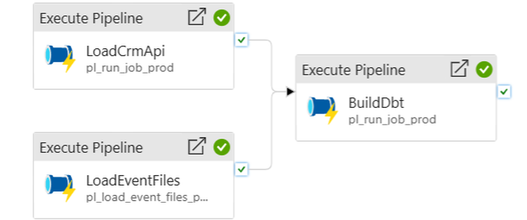
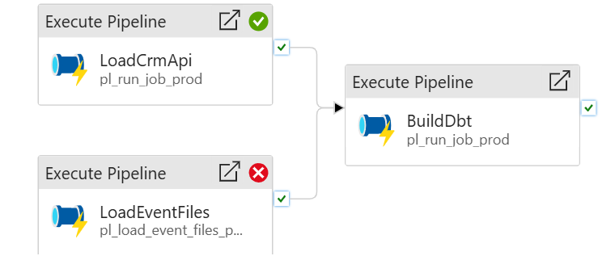
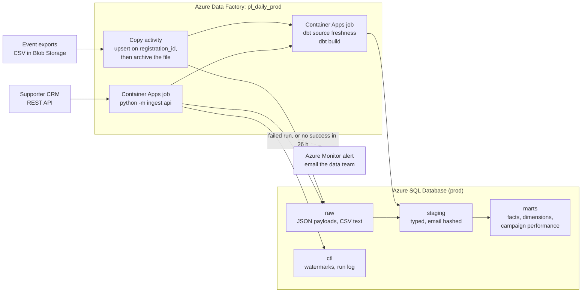

<div align="center">

# Azure Data Factory, dbt and Azure SQL warehouse

**A charity data warehouse on Azure, built to keep running after the engineer who built it has gone.**

[](https://github.com/gbadedata/azure-adf-dbt-warehouse/actions/workflows/ci.yml)
[](docs/evidence/azure-2026-11-13.md)


[](LICENSE)

[Proof](#proof) · [Quick start](#quick-start) · [Architecture](#architecture) · [How a day runs](#how-a-day-runs) · [Cost](#what-it-costs) · [What is verified](#what-has-and-has-not-been-verified) · [Runbook](docs/runbook.md) · [Handover](docs/handover.md) · [Decisions](docs/decisions.md)

</div>

Data Factory loads a supporter CRM's REST API and an events platform's CSV exports into Azure SQL. dbt turns them into reporting tables in separate dev and prod databases, and Azure Monitor emails the team when a run fails or when no run succeeds for a day. Everything is in Terraform, every service signs in with a managed identity, and the runbook and handover pack are written for the analysts who look after it next.

The data is **synthetic**, generated from a fixed seed. No real organisation or person is involved.

## Proof

Deployed to Azure on 13 November 2026, run three times (day one, day two, then day two again), checked against the source, then removed. [Full record](docs/evidence/azure-2026-11-13.md).

| 3 of 3 | 100 of 100 | 4 of 4 | 0 | 2 min |
|:---:|:---:|:---:|:---:|:---:|
| daily Data Factory runs succeeded | campaign figures in the prod marts matching an independent recalculation from the source | late-arriving donations caught | rows changed by the replayed day | from a failed run to the alert firing |

<table>
<tr>
<td></td>
<td></td>
</tr>
<tr>
<td align="center">A normal day: both loads succeed, then dbt builds</td>
<td align="center">A bad file: the file load fails, so dbt never starts and the reports keep the last good data</td>
</tr>
</table>

The same checks run in CI on every push, against SQL Server 2022, and give identical numbers ([CI run log](docs/evidence/ci-end-to-end.md)).

**The late donations are the hard part.** Four donations are stamped eight minutes *before* the day-one high watermark but only become visible on day two, as happens when a source commits late. A loader that asks for "everything after the watermark" never sees them. This one re-reads a 30-minute overlap, and the merge only accepts strictly newer versions, so the overlap re-reads one row and loses nothing. [A test](tests/test_pipeline.py) shows the same load without the overlap losing exactly those four.

**A failure was tested for real.** In the first deployment a file load failed. dbt was held back, so the reports kept the last good data; the file stayed in `incoming` for the next run; and the failure alert fired two minutes later.

**The first deployment found three problems no CI check could see**, each now fixed:

- the subscription had never been registered for Container Apps, so `deploy.sh` now registers every provider it needs first;
- Terraform's delimited-text dataset sends an empty row delimiter, which Data Factory rejects only when the Copy activity runs, so the dataset is now raw JSON without it;
- replacing that dataset made Terraform delete it while a pipeline still used it, which the runbook now covers.

A pass on synthetic data has a narrow meaning: the pipeline does what it claims on that data. It is not a production track record.

## Quick start

**Tests, no database** (Python 3.11 or later):

```bash
pip install -r requirements-dev.txt && pytest -m "not sqlserver"
```

**End to end against SQL Server 2022**: two days of loads, a replay, `dbt build`, then the independent check. Needs ODBC Driver 18 ([installer for Ubuntu](scripts/ci/install_odbc.sh)).

```bash
docker run -d -e ACCEPT_EULA=Y -e MSSQL_SA_PASSWORD='Your-Strong-Passw0rd' -p 1433:1433 mcr.microsoft.com/mssql/server:2022-latest
SQL_PASSWORD='Your-Strong-Passw0rd' bash scripts/run_e2e.sh
```

**In your own Azure subscription**: needs the Azure CLI, Terraform and Python. Images are built in Azure, so Docker is not required.

```bash
ALERT_EMAILS=you@example.org bash scripts/azure/deploy.sh   # about 20 minutes; asks before creating anything
bash scripts/azure/demo_failure.sh                          # a bad file: dbt held back, file kept, alert fires
bash scripts/azure/demo_run.sh                              # three daily runs, then the independent check
bash scripts/azure/evidence.sh                              # pipeline runs, job executions, alerts fired
bash scripts/azure/teardown.sh                              # removes everything
```

For a real source instead of the demo CRM, follow [the runbook](docs/runbook.md#first-deployment).

## Architecture



[`infra/terraform`](infra/terraform) creates all of it: the SQL server with a serverless database per environment, landing storage, Data Factory with its linked services, datasets, pipelines and triggers, the Container Apps jobs and registry, Log Analytics and the alerts. There are no keys or passwords in the code or in Data Factory, and SQL logins are disabled on the server.

## How a day runs

1. **06:10 UTC.** The schedule trigger starts `pl_daily_prod`.
2. **Two loads in parallel.**
   - **API.** The ingest job asks the CRM for everything changed since the high watermark minus 30 minutes, follows the cursor through every page, waits out 429s (honouring `Retry-After`), backs off on 5xx, and `MERGE`s each page into `raw`. The watermark moves only after the last page, so a failed run is simply repeated.
   - **Files.** Data Factory upserts each new CSV into `raw.event_registrations` on `registration_id`, and only then moves the file to the archive. A file that fails stays where it is.
3. **dbt, only if both loads succeeded.** `dbt source freshness` (fails if a source is 50 hours stale), then `dbt build`. A failed test fails the run, and the marts keep the last good data.
4. **Alerts.** Any failure fires the failed-run alert. No successful prod run for 26 hours, for example because the trigger was switched off, fires the silence alert.

Data Factory starts each job through the Azure Resource Manager API with its own managed identity and polls until it finishes ([`run_job.json.tftpl`](adf/pipelines/run_job.json.tftpl)).

## Environments

| Target | Database | Schemas | Signs in as | Used by |
|---|---|---|---|---|
| `local` | dev | `dbt_<you>_staging`, `dbt_<you>_marts`, ... | you, through `az login` | an analyst developing a model |
| `ci` | throwaway | `ci_<run>_...`, dropped afterwards | SQL login on a CI container | every push |
| `dev` | `sqldb-warehouse-dev` | `staging`, `intermediate`, `marts` | the dev jobs' managed identity | the deployed dev environment |
| `prod` | `sqldb-warehouse-prod` | `staging`, `intermediate`, `marts` | the prod jobs' managed identity | the deployed prod environment |

Dev and prod are separate databases, so development can never overwrite a production table. The [Azure DevOps pipelines](azure-pipelines) run `dbt build` for each pull request in a throwaway `pr_<id>` schema, build the image once on merge, prove it in dev with a real dbt run, then wait for **approval** before prod.

## The warehouse

| Model | Grain | Notes |
|---|---|---|
| `fct_donations` | donation | Latest state. `net_amount_gbp` counts paid gifts only. Gift Aid at 25p per £1 on eligible paid gifts. |
| `fct_event_registrations` | registration | Matched to supporters on a hashed email; sign-ups from people not in the CRM are kept. |
| `dim_supporters` | supporter | Giving totals. No email, name or hash. |
| `dim_campaigns` | campaign | Budget, channel, dates. |
| `mart_campaign_performance` | campaign | Supporters acquired, donors, gross, refunds, net, Gift Aid, pending, event sign-ups, cost per supporter, income per pound spent. |

48 tests guard it, three of which check the whole rather than a column:

- [**no personal data in marts**](dbt/tests/assert_no_personal_data_in_marts.sql): analysts are granted `marts` only, and staging, which holds emails, is restricted;
- [**rows reconcile to raw**](dbt/tests/assert_rows_reconcile_to_raw.sql): nothing lost or invented between raw and marts;
- [**campaign totals reconcile**](dbt/tests/assert_campaign_totals_reconcile.sql): the report adds up to the donations behind it.

## What it costs

An estimate for prod running daily with dev idle, from pay-as-you-go list prices in US dollars before VAT. Prices vary by region and change, so check the [pricing calculator](https://azure.microsoft.com/pricing/calculator/).

| Item | Assumption | Per month |
|---|---|---:|
| Azure SQL, prod compute | Online about 65 minutes a day: 5 minutes of work, then the 60-minute auto-pause delay. [Billed](https://learn.microsoft.com/azure/azure-sql/database/serverless-tier-billing) at 0.67 to 1 vCore (the higher of CPU and memory used, never below the minimum) at $0.000145 per vCore-second | $11 to $17 |
| Azure SQL, dev compute | Paused unless someone is developing | $0 |
| Azure SQL storage | Two databases, 5 GB maximum each | about $1 |
| [Container Registry](https://azure.microsoft.com/pricing/details/container-registry/), Basic | Always on, $0.167 a day | $5 |
| [Data Factory](https://azure.microsoft.com/pricing/details/data-factory/data-pipeline/) orchestration | About 40 activity runs a day (each 30-second poll of a job counts), $1 per 1,000 | about $1 |
| Data Factory data movement | Two small copies a day, each billed as at least a minute at 4 DIUs, $0.25 per DIU-hour | about $1 |
| [Container Apps](https://learn.microsoft.com/azure/container-apps/billing) jobs | About 4 minutes a day at 0.5 vCPU and 1 GiB | $0, inside the monthly free grant |
| [Log Analytics and alerts](https://azure.microsoft.com/pricing/details/monitor/) | Far under the free 5 GB a month; one hourly log alert, one metric alert | under $1 |
| **Total** | | **about $20 to $26** |

The biggest lever is the auto-pause delay. The database keeps billing for the hour it waits after the run; at the 15-minute minimum it would be online about 20 minutes a day, and the total would fall to around $12 to $14. The registry is the largest fixed cost after that.

## What has and has not been verified

| Part | Status |
|---|---|
| API loader: tokens, pagination, retries, watermarks, `MERGE`, run log | CI (unit, and integration on SQL Server 2022), and **ran in Azure** |
| File loads: upsert on key, archive only after success | Data Factory's upsert **ran in Azure**; the Python equivalent is tested in CI |
| dbt: models, 48 tests, freshness, schema naming | CI, and **ran in Azure** against Azure SQL with a managed identity |
| End to end: two days, replay, independent recalculation | CI on every push, and **once in Azure** |
| Terraform | `fmt` and `validate` in CI; **applied** in UK South, then destroyed |
| Data Factory pipelines | Static checks in CI; **ran in Azure**, including a failure that held dbt back and kept the file |
| Failure alert | **Fired in Azure**, two minutes after a failed run |
| Silence alert (no success in 26 hours) | Deployed, **not exercised**: the schedules were off for the demonstration |
| Azure DevOps pipelines | Written to mirror the GitHub workflow; **not yet run** in an Azure DevOps organisation |
| Weeks on a daily schedule, with a real source | **Not done**: the deployment lasted an afternoon |

## Decisions and limits

Three decisions do most of the work. [docs/decisions.md](docs/decisions.md) has all twelve, each with its trade-off and when to revisit it.

- **API records land as JSON and dbt types them**, so a new source field never breaks a load.
- **Re-read an overlap, merge only newer versions, move the watermark last**, so late records are caught and any page, run or day can be replayed safely.
- **Python in Container Apps jobs, started by Data Factory.** Data Factory has no native step for an OAuth-and-cursor API or for dbt; one job pattern runs both, while scheduling and alerts stay in Data Factory.

Known limits: deletions at source are not detected, because the API reports changes only; SQL accepts connections from Azure services rather than through a private endpoint; the CRM secret is a Container Apps secret rather than a Key Vault reference; and if two exports of the same registration wait in `incoming` together, which version wins is not guaranteed.

## Repository layout

```text
src/ingest/          API loader and file loader (python -m ingest)
sql/                 Control and raw tables, safe to re-run
dbt/                 Models, tests, schema macros, profiles for local, ci, dev and prod
adf/pipelines/       Data Factory pipeline definitions (rendered by Terraform)
infra/terraform/     All Azure resources, and the SQL grants script as an output
azure-pipelines/     Azure DevOps CI (pull requests) and CD (dev, then prod with approval)
.github/workflows/   The same checks on GitHub Actions
mock_api/            Synthetic source data and a stand-in CRM API
scripts/             End-to-end run and independent check
scripts/azure/       Deploy, demonstrate, record evidence and tear down in your own subscription
tests/               Unit, pipeline-definition and SQL Server integration tests
docs/                Runbook, handover pack, decisions, evidence from CI and Azure
```

---

Built by **Oluwagbade Odimayo** · [Portfolio](https://gbadedata.com) · [LinkedIn](https://www.linkedin.com/in/oluwagbade-odimayo-)
