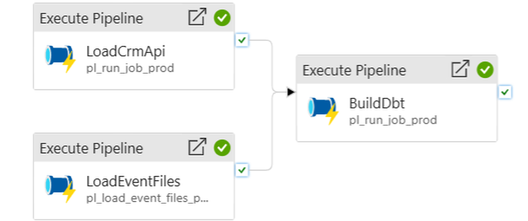
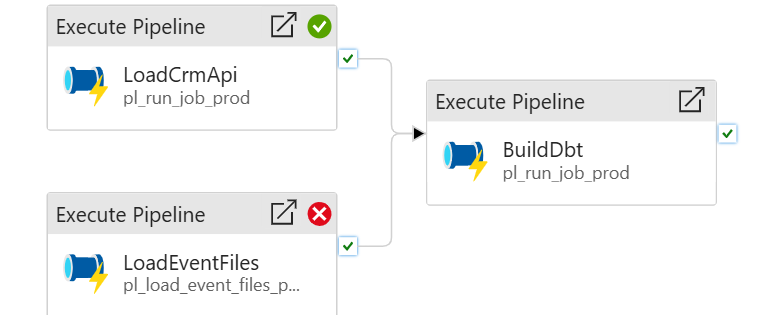

# Azure run, 13 November 2026

Deployed twice (the [second deployment](#second-deployment) is at the end) into a pay-as-you-go subscription in UK South with `scripts/azure/deploy.sh`,
run with `scripts/azure/demo_run.sh`, recorded with `scripts/azure/evidence.sh`, then
removed with `scripts/azure/teardown.sh`. The source was the synthetic CRM API
(`Dockerfile.mock`) running as a Container App; everything else is the production
configuration.

## Pipeline runs

| Started (UTC) | Pipeline | Status | Duration |
|---|---|---|---:|
| 17:25:29 | `pl_daily_prod` | **Failed** | 202 s |
| 17:25:37 | `pl_run_job_prod` (ingest) | Succeeded | 96 s |
| 17:25:37 | `pl_load_event_files_prod` | **Failed** (defect 2 below) | 192 s |
| 17:55:47 | `pl_daily_prod`: day 1 | Succeeded | 189 s |
| 17:55:53 | `pl_run_job_prod` (ingest) | Succeeded | 95 s |
| 17:55:53 | `pl_load_event_files_prod` | Succeeded | 62 s |
| 17:57:29 | `pl_run_job_prod` (dbt) | Succeeded | 85 s |
| 17:59:37 | `pl_daily_prod`: day 2 | Succeeded | 158 s |
| 17:59:43 | `pl_run_job_prod` (ingest) | Succeeded | 52 s |
| 17:59:43 | `pl_load_event_files_prod` | Succeeded | 54 s |
| 18:00:38 | `pl_run_job_prod` (dbt) | Succeeded | 96 s |
| 18:02:19 | `pl_daily_prod`: replay of day 2 | Succeeded | 281 s |
| 18:02:25 | `pl_load_event_files_prod` | Succeeded | 103 s |
| 18:02:25 | `pl_run_job_prod` (ingest) | Succeeded | 51 s |
| 18:04:10 | `pl_run_job_prod` (dbt) | Succeeded | 168 s |

In the failed run the API load succeeded and the file load failed, so `BuildDbt` never
started: dbt only runs when both loads succeed. The file stayed in `incoming` and was
loaded by the next run.

## Alert

| Fired (UTC) | Rule | Severity |
|---|---|---|
| 17:31:32 | `alert-adf-pipeline-failed` | Sev1 |

Two minutes 41 seconds after the failed run ended. In the second deployment the alert
took 6 and 7 minutes ([below](#second-deployment)). The silence alert ("no successful run in
26 hours") was not exercised: the schedules were off for the demonstration.

## Container Apps job executions

| Job | Started | Ended | Status |
|---|---|---|---|
| ingest | 17:25:51 | 17:26:40 | Succeeded |
| ingest | 17:56:08 | 17:56:56 | Succeeded |
| dbt | 17:57:33 | 17:58:47 | Succeeded |
| ingest | 17:59:46 | 18:00:18 | Succeeded |
| dbt | 18:00:42 | 18:01:49 | Succeeded |
| ingest | 18:02:29 | 18:02:59 | Succeeded |
| dbt | 18:04:14 | 18:06:21 | Succeeded |

Both jobs signed in to Azure SQL with their user-assigned managed identity; Data Factory
wrote the file loads with its system-assigned identity. No passwords were used.

## Run log (`ctl.ingestion_runs`, prod)

The tables were emptied at the start of the demonstration, so this covers the three
successful runs only.

| Run | Entity | Received | Inserted | Updated |
|---|---|---:|---:|---:|
| Day 1 | campaigns | 10 | 10 | 0 |
| Day 1 | supporters | 2,400 | 2,400 | 0 |
| Day 1 | donations | 7,179 | 7,179 | 0 |
| Day 2 | campaigns | 1 | 0 | 1 |
| Day 2 | supporters | 151 | 120 | 30 |
| Day 2 | donations | 420 | 354 | 65 |
| Replay | campaigns | 1 | 0 | 0 |
| Replay | supporters | 5 | 0 | 0 |
| Replay | donations | 13 | 0 | 0 |

Identical to the CI run on SQL Server 2022.

## Independent check against the source

`scripts/verify_e2e.py`, run against the prod database after the third run:

```json
{
 "passed": true,
 "campaign_values_compared": 100,
 "counts": {
  "raw_supporters": 2520,
  "raw_donations": 7533,
  "raw_registrations": 360,
  "fct_donations": 7533,
  "registrations_matched": 283,
  "mart_email_columns": 0
 },
 "late_commits_found": "4 of 4",
 "failures": []
}
```

Files archived after successful upserts:

```text
prod/archive/event_registrations/2026/11/13/event_registrations_20261101.csv
prod/archive/event_registrations/2026/11/13/event_registrations_20261102.csv
```

## What the first deployment found

Three problems that the CI checks could not see, each fixed in the repository:

1. **`MissingSubscriptionRegistration` for `Microsoft.App`.** The subscription had never
   used Container Apps. `deploy.sh` now registers every resource provider the project
   needs before creating anything.
2. **`Column Delimiter must be empty string when Row Delimiter is empty`.** The Terraform
   resource for a delimited-text dataset sends an empty `rowDelimiter` when none is set,
   and Data Factory rejects that when the Copy activity runs. Terraform's own validation
   and the pipeline checks in CI both passed it. The dataset is now defined in raw JSON
   with `rowDelimiter` left out, so Data Factory accepts `\r\n`, `\r` or `\n`.
3. **`The document cannot be deleted since it is referenced by pl_load_event_files_prod`.**
   Replacing the dataset made Terraform delete the old one before repointing the
   pipeline. Fixed by applying the pipeline change first
   (`update_infra.sh -target=azurerm_data_factory_pipeline.load_event_files`), then the
   rest. The runbook now covers this for future dataset changes.

## Second deployment

Deployed again the same evening, into a new resource group, from the repository with the
three fixes above. The aim was to show the deployment repeats cleanly and to fail it on
purpose with `scripts/azure/demo_failure.sh`, which uploads an event file with the wrong
header. Nothing needed fixing.

| Started (UTC) | `pl_daily_prod` run | Status | Duration |
|---|---|---|---:|
| 19:20:21 | malformed file | **Failed**, as intended | 209 s |
| 19:32:10 | day 1 | Succeeded | 193 s |
| 19:36:01 | day 2 | Succeeded | 182 s |
| 19:39:16 | replay of day 2 | Succeeded | 145 s |
| 19:56:14 | malformed file, again | **Failed**, as intended | 208 s |

In both failed runs the API load succeeded, the file load failed, and dbt never started:
the dbt job has exactly three executions (19:33:57, 19:37:01 and 19:40:15), one for each
good run. The run log and the independent check were identical to the first deployment's:
100 of 100 campaign figures, 4 of 4 late commits, and the replay re-read 19 rows and wrote
none.

| Run failed (UTC) | Alert fired (UTC) | Delay |
|---|---|---:|
| 17:28:51 (first deployment) | 17:31:32 | 2 min 41 s |
| 19:23:50 | 19:30:53 | 7 min 3 s |
| 19:59:43 | 20:05:48 | 6 min 5 s |

The alert rule evaluates Data Factory's failed-runs metric every 5 minutes, and the metric
reaches Azure Monitor with a short delay, so 3 to 7 minutes is what to expect. Evaluating
every minute would shorten the wait; metric alerts are priced per time series monitored,
not by frequency.

Screenshots from Data Factory's monitor, from this deployment:

| A normal day | A malformed file |
|---|---|
|  |  |
